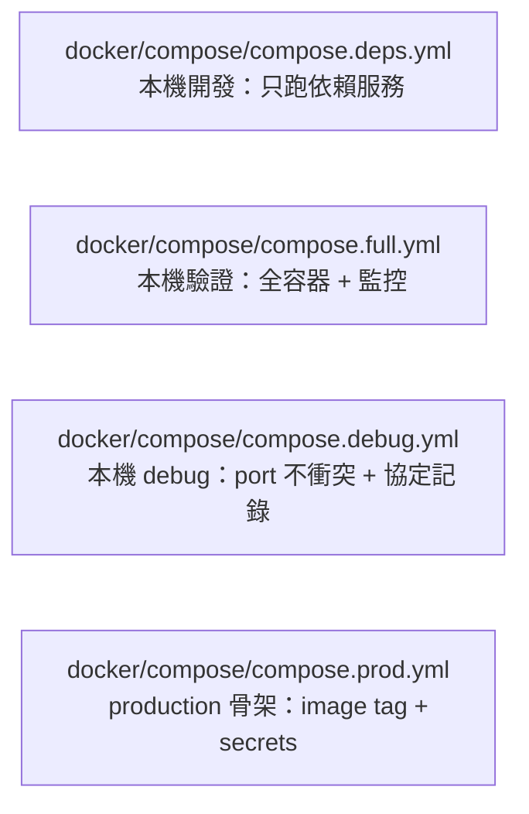

# Docker 生產部署

這份文件涵蓋 production 部署從 compose 骨架到實際上線的完整流程。

## 與其他 compose 的差異



### `docker/compose/compose.deps.yml`

用途：本機 GoLand 開發，只跑依賴服務（MySQL / Redis / RabbitMQ）。

### `docker/compose/compose.full.yml`

用途：本機完整容器驗證，驗證 image build、容器網路、監控串接。

### `docker/compose/compose.debug.yml`

用途：本機完整 debug 容器驗證，可和 `docker/compose/compose.prod.yml` 同機並跑（port 不衝突），`DEBUG_PROTOCOL_RECORD=true` 預設開啟。

### `docker/compose/compose.prod.yml`

用途：production 部署骨架，以 image tag 與 secrets/env 為主，不常駐 `user` client。

---

下面進入 production 部署的完整流程：image build → push → deploy → rollback。

## 1. 準備環境變數

先從：

- [.env.prod.example](../../.env.prod.example)

複製成你自己的 `.env.prod`，並至少修改：

- `MYSQL_ROOT_PASSWORD`
- `MYSQL_PASSWORD`
- `REDIS_PASSWORD`：正式 Redis 以 `requirepass` 啟動，Central、World、Gate、Lobby 以 `redis.password` 讀取；未設定時 compose 直接報錯。Redis 容器的啟動指令先 `rm -f /tmp/redis.conf` 再寫入設定檔（`umask 077`、`chown redis:redis`）：容器重啟時舊檔留在 `/tmp`，sticky 目錄保護使 `>` 覆寫失敗，Redis 就起不來
- `GRAFANA_ADMIN_PASSWORD`
- `REGISTRY`
- `IMAGE_TAG`
- `CENTRAL_IMAGE`
- `WORLD_IMAGE`
- `GATE_IMAGE`
- `CHAT_IMAGE`
- `LOBBY_IMAGE`
- `RECORD_IMAGE`
- `RABBITMQ_USER`／`RABBITMQ_PASSWORD`（密碼只用 URL 安全字元，compose 會組成 `RABBITMQ_URL`；World 與 Record 啟動時驗證 `rabbitmq.url` 可解析且密碼不是 `change_me` 佔位值，壞值直接啟動失敗，錯誤訊息不含密碼；佔位檢查只在 `mqstartup.CheckURL`（`pkg/recordmq` 不依賴 bootstrap），World 在純設定階段 `worldSettings` 就檢查，早於任何外部連線）
- **佔位密碼拒絕啟動**：`REDIS_PASSWORD`、`MYSQL_PASSWORD`、`MYSQL_ROOT_PASSWORD`、`RABBITMQ_PASSWORD`、`GRAFANA_ADMIN_PASSWORD` 若仍以 `change_me`／`change-me` 開頭（照抄 `.env.prod.example`）：Central、Chat、Record、World 開資料庫前（Redis、MySQL 密碼）拒絕啟動，`scripts/ci-deploy.sh` 的 `preflight_secrets` 在關服前就中止部署（RabbitMQ 另外在 World、Record 啟動時由 `mqstartup.CheckURL` 檢查 `rabbitmq.url` 的密碼，所以不經 `ci-deploy.sh` 手動 `compose up` 也會被擋；只有 Grafana 不經 Go 程式讀取）。請用隨機值（例如 `openssl rand -hex 24`；RabbitMQ 密碼只用 URL 安全字元）
- `LOTTERY_SECRET`：World 抽獎種子機密，覆寫 `docker/prod/config/world.yaml` 的 `lottery.secret`；未設定時 compose 直接報錯；World 啟動另拒絕短於 16 字元或 `change-me`／`change_me` 開頭的值（照抄範本佔位會啟動失敗）
- `GRAFANA_ADMIN_USER`（預設 `admin`）
- `PROMETHEUS_IMAGE`／`ALERTMANAGER_IMAGE`／`GRAFANA_IMAGE`／`REDIS_IMAGE`／`RABBITMQ_IMAGE`／`MYSQL_IMAGE`：第三方映像，範本已釘 digest，升級時一併更新
- `MIGRATION_PLAN_DIR`（映像**不含** migrations。留空時：CD 的 `ci-deploy.sh` 把部署主機的 `deps/PJA-Database` 掛成容器內 `/src`，讀 `/src/migrations`；手動執行 `migrate-prod.sh` 預設讀 `${ROOT_DIR}/migrations`。自訂值須為**宿主機上已存在的絕對路徑**，以唯讀、同路徑掛入；相對路徑或不存在的目錄，`ci-deploy.sh` 在關服前就報錯中止，因為 docker 對不存在的 bind 來源會無聲建出空目錄，datamigrate 會把它當成沒有 plan 而略過 migration）／`MIGRATION_ENVIRONMENT`（`production`）／`MIGRATION_TIMEOUT`（`5m`）／`MIGRATION_LOCK_TIMEOUT`（`30s`）：一次性 migration job 使用，服務啟動不跑 migration
- `LOBBY_ADMIN_TOKEN`／`LOBBY_OPS_TOKEN`／`LOBBY_GM_TOKEN`（需要 Lobby admin 端點時；每個至少 32 字元，例如 `openssl rand -hex 32`，過短或 `change-me` 開頭會拒絕啟動）
- `DATA_CONFIG_ROOT`：宿主機上的遊戲設定 artifact root（`current.json` 與 `releases/`），以唯讀方式掛到 World 的 `/app/config/data`

不要把真正的 `.env.prod` 提交到版本庫。

### 遊戲設定 artifact

World 啟動時要求 `current.json`，正式環境不得開啟 `data_config.allow_legacy_directory`。部署前先在宿主機發布 artifact：

```powershell
.\scripts\publish-data-config.ps1 -Source config\data -Root <DATA_CONFIG_ROOT>
```

World 唯讀掛載並監看此目錄，熱重載只採用白名單內的變更，不改寫 `current.json`。熱重載被拒時 World 保留目前快照並記錄 `data_config_reload_total{result="rejected"}`，但 `current.json` 仍指向被拒的版本，World 重啟會改載入該版本（若該版本的 `client_contract`、`min_config_seq`、`config_version`、`config_seq` 與映像內嵌的 `release.json` 不符，World 會拒絕啟動）；先以 `rollback-data-config-release.ps1` 切回可用版本，或依[配置 Artifact 發布與回退](配置Artifact發布與回退.md)完成需要重啟的變更。

### 機密與對外連接埠

- **首次部署前先檢查佔位密碼**：`.env.prod` 裡 `MYSQL_ROOT_PASSWORD`、`MYSQL_PASSWORD`、`REDIS_PASSWORD`、`RABBITMQ_PASSWORD`、`GRAFANA_ADMIN_PASSWORD` 不可是 `change_me`／`change-me` 開頭的範本值（`grep -inE 'change[_-]me' .env.prod` 應無輸出）。Go 服務只擋自己讀的 MySQL 應用帳號、Redis 與 `RABBITMQ_URL` 的佔位密碼（拒絕啟動）；MySQL root 與 Grafana 只有 CI 部署腳本的 preflight 會擋，而首次手動 `compose up` 不經過它。MySQL、RabbitMQ 的密碼只在資料卷**第一次初始化**時生效，之後改 `.env.prod` 不會改變實際密碼，必須另外執行 `ALTER USER`／`rabbitmqctl change_password`；若照範本初始化過，要視為密碼已洩漏而更換。
- MySQL 帳密只由環境變數提供：compose 把 `MYSQL_USER`／`MYSQL_PASSWORD`／`MYSQL_DATABASE` 以 `MYSQL_USERNAME`／`MYSQL_PASSWORD`／`MYSQL_DBNAME` 注入 Central、World、Chat，設定檔的 `mysql.password` 留空。
- RabbitMQ 只承載 Record 事件（World 一般事件與 MySQL record outbox → Record）；任務進度在玩家請求內同步套用，不經 RabbitMQ（任務佇列已於 2026-10-08 移除）。World 啟動時連不上 RabbitMQ 不拒絕啟動，改在背景重試，見 [RabbitMQ 發布可靠性](../00-導讀/RabbitMQ發布可靠性.md#啟動連不上-rabbitmq)。正式 compose 內含 `rabbitmq` 服務，只在內部網路提供；World 以 `RABBITMQ_URL` 連線，設定檔的 `rabbitmq.url` 留空。
- Central 有設定 Redis（`redis.addr` 或 `redis.master_name` 任一非空）卻在啟動時連不上，直接拒絕啟動，不再靜默降級成單機記憶體模式；兩者皆空才走單機記憶體模式（僅開發與測試）。正式 compose 的 `central` 因此 `depends_on` `redis`（`service_healthy`）。
- **Docker Compose 最低版本 v2.24**：`scripts/production-smoke.ps1` 以 `docker compose config --environment` 讀 `.env.prod` 的值，該旗標從 v2.24 才有；舊版會回非 0，腳本直接中止並提示升級，不會再靜默讀成空值（空的 `GRAFANA_ADMIN_PASSWORD` 會讓煙霧測試以 401 誤判失敗）。部署主機請先 `docker compose version` 確認。
- **容器硬化（`x-app` 共用段）**：應用容器設 `read_only: true`（根檔案系統唯讀）、`tmpfs: [/tmp]`（暫存寫入）與 `pids_limit: 512`（行程／執行緒數上限，擋 fork 失控）。World 的 `/app/spill` 是具名資料卷，不受唯讀影響。**未在 staging 驗證**：首次部署前先在 staging 確認 healthcheck、`GOTRACEBACK` 堆疊輸出與各服務寫檔（日誌、spill、debug 暫存）沒有因唯讀根檔案系統失敗；有問題就把該路徑加進 `tmpfs` 或 volume，不要拿掉 `read_only`。
- `RECORD_HTTP_TOKEN`（選填）：Record 的 `/events` 預設只綁容器內 `127.0.0.1:6070`；要從其他主機查詢而在 `docker/prod/config/record.yaml` 設 `addr` 時**必須**同時提供 token，否則 Record 拒絕啟動（`checkHTTPToken`）。compose 把 `.env.prod` 的 `RECORD_HTTP_TOKEN` 以環境變數 `HTTP_TOKEN` 轉傳給 Record；`.env.prod.example` 的選填段列有此項，留空等同未設定。
- 服務映像為必填（`${X_IMAGE:?}`），未設定時 compose 直接報錯，不會退回 `:latest`。
- Lobby admin token 只由環境變數提供；三個 token 都空白時 admin 端點停用，`change-me` 開頭的佔位值會拒絕啟動。admin 端點預設監聽容器內 `127.0.0.1:8081`，需要從內網存取時以 `LOBBY_ADMIN_ADDR` 綁內網介面。
- 只有 Gate `62001` 與 Lobby `8080` 對外。Lobby `:8080` 同時連線上限 2048、每個來源 IP（IPv6 以 /64 計）每秒 20 個請求、突發 40，超過回 429；每個請求 3 秒處理期限（唯讀 GET／HEAD 逾時回 503；寫入型請求只設 ctx 期限，不由中介層回 503，GM 重試仍須帶 `operationID`）；公開 listener（Lobby、Record `/events`）的 keep-alive 閒置上限 5 秒。Central／World／Chat 的 S2S 連接埠與 Prometheus、Grafana 只綁主機 `127.0.0.1`；監控經 SSH 通道或反向代理存取，Prometheus 不開 lifecycle API。跨主機部署時改綁內網介面。
- 正式設定一律啟用 S2S 驗證：`.env.prod` 的 `S2S_SECRET_DIR` 指向機密目錄，compose 把其中的 `central/`、`chat/`、`world-1001/`、`gate-2001/`、`lobby-4001/` 分別唯讀掛載到各服務的 `/run/secrets`（Chat、Lobby 也以 S2S 連 Central 60003／60004 接收遊戲時間）；缺少憑證或 token 時服務拒絕啟動。機密的產生、發送與輪替見 [[S2S身份驗證]]。
- debug 端點（`/metrics`、`/ready` 等）的來源白名單由 `DEBUG_ALLOW_CIDRS` 決定，compose 會自動在後面接上 `PROD_NETWORK_SUBNET`（預設 `172.30.0.0/24`），讓 Prometheus 容器抓得到 `/metrics`。S2S 來源 IP 白名單同樣跟著 `PROD_NETWORK_SUBNET` 走：`compose.prod.yml` 對 Central 轉傳 `S2S_AUTH_ALLOWED_CIDRS`、`S2S_AUTH_WORLD_ALLOWED_CIDRS`、`S2S_AUTH_CHAT_ALLOWED_CIDRS`、`S2S_AUTH_LOBBY_ALLOWED_CIDRS`，對 World、Chat 轉傳 `S2S_AUTH_ALLOWED_CIDRS`，值都是 `${PROD_NETWORK_SUBNET:-172.30.0.0/24}`；`docker/prod/config/{central,chat,world}.yaml` 的 6 處 `allowed_cidrs: ["172.30.0.0/24"]` 只是未走 compose 時的預設。因此改了 `PROD_NETWORK_SUBNET` 不必另改這些設定檔（`tools/internal/configaudit` 守門 compose 必須轉傳、預設網段等於 yaml 預設）；只有在設定檔或其他地方另外手寫 `allowed_cidrs`（不經上述環境變數）時，才須與 `PROD_NETWORK_SUBNET` 同步，否則 Prometheus 抓取失敗觸發 `GameServiceDown`，或 S2S 依來源 IP 全部被拒（`S2S source IP not allowed`）。
- `DEBUG_ALLOWED_HOSTS`（選填，逗號分隔，支援 `*.suffix`）：`Host` 標頭白名單（`pkg/httpx` 的 `HostAllowlist`，防 DNS 重綁定），**debug 伺服器、Lobby admin 路由（token 比對前）與 Record `/events`（最外層）共用同一份規則與同一個環境變數**，不符回 403；Lobby admin 與公開 discovery 共用 listener 時只守 admin 路由，公開路由仍收任意網域。debug 伺服器的 `accessGuard` 除了來源 IP 也檢查 `Host` 標頭，內建接受 IP 字面值、`localhost`、`*.localhost`、`host.docker.internal` 與不含 `.` 的單一標籤名稱（compose 服務名），Prometheus 以 FQDN 抓取才需要列入；CIDR 或 Host 不符的 403 會記取樣 Warn 日誌；`compose.prod.yml` 六個應用服務都轉傳 `${DEBUG_ALLOWED_HOSTS:-}`（`.env.prod.example` 的選填覆寫段有範例），不必再手補 `environment`。
- `DEBUG_PPROF_BASIC_AUTH`（`user:pass`）**必填**：`compose.prod.yml` 六個服務都用 `${DEBUG_PPROF_BASIC_AUTH:?...}`，`.env.prod` 沒設定時 `compose up` 直接失敗（`.env.prod.example` 已改為必填範例）。密碼至少 16 字元、不可 `change-me` 開頭；有設定但不合格時，pprof 與 Gate `/diag/session`、`/diag/player`、`/diag/reconcile`（GET 與 POST）一律回 503 並記 Error。**升級正式環境前必須先在 `.env.prod` 設好這個值**，否則 `compose up` 會失敗。它保護 `/debug/pprof/*` 與 Gate `/diag/session`、`/diag/player`、`/diag/reconcile`（GET 與 POST；`/diag/protocol` 不受保護）；而 pprof 本身在正式環境缺省**關閉**（`docker/prod/config/*.yaml` 沒有 `debug.pprof_enabled`，要開需在該服務設定寫 `debug.pprof_enabled: true` 並重啟，見[問題排查筆記](../20-排障與監控/問題排查筆記.md#現場採證服務卡住cpu-高記憶體持續成長)）。
- `LOG_ASYNC_BUFFER`（選填，筆數，預設 0＝關閉，行為與以前相同）：開啟後日誌進 zerolog diode 環形緩衝、由單一 goroutine 寫 stderr，Gate／World 事件迴圈不再為每行付 write syscall（本機 benchmark 約 2.6µs/op → 0.19µs/op）。取捨：緩衝滿了丟最舊日誌，計入 `logger_async_dropped_total` 並在 stderr 寫一行 Warn `async log buffer overflow, entries dropped`；行程崩潰（panic、SIGKILL）時緩衝內最後幾筆可能遺失，正常結束由 `startup.Main` 的 `logger.Close()` 排空；標準庫 `log` 橋接在非同步模式下同步寫 stderr、不經緩衝；值寫錯時記 Warn `LOG_ASYNC_BUFFER invalid, async logging disabled` 並維持同步日誌（細節見[日誌輸出格式](../00-導讀/日誌輸出格式.md#非同步日誌log_async_buffer)）。建議壓測時先在單一服務試開（例如 8192）並觀察 `logger_async_dropped_total`，未決定正式環境是否預設開啟。
- `compose.prod.yml` 把 `.env.prod` 的下列**選填執行期覆寫變數**轉進六個應用服務的 `environment`（`--env-file` 只用於 compose 內插，沒轉進 `environment` 的變數容器收不到；留空等同未設定）：`LOG_FORMAT`、`LOG_SAMPLE_RATE`、`LOG_ASYNC_BUFFER`、`PPROF_MUTEX_FRACTION`、`PPROF_BLOCK_RATE`、`DEBUG_ALLOWED_HOSTS`。`DATA_CONFIG_VERSION_PATH` 只供非 compose 部署：compose **沒有**在頂層掛 `version.json`（artifact root 只有 `current.json` 與 `releases/`），所以六個服務每次啟動都固定記一次 Warn `data config version manifest not found`，屬已知且無害；World 另外驗證所載入 release 目錄自帶的 `version.json`（`client_contract`、`config_version` 等與映像內嵌的 `release.json` 比對，見上節）。`tools/internal/configaudit` 守門：範本可覆寫段列出的名稱必須出現在每個服務的 `environment`，且 compose 的每個環境變數名稱必須對得上程式讀取者（`os.Getenv`）或某個 viper 鍵轉大寫底線的結果，日後改鍵名（例如 `mysql.username` 改 `mysql.user`）造成覆寫失效會在測試就被抓到。
- 日誌層級由 `.env.prod` 的 `LOG_LEVEL`（`trace`／`debug`／`info`／`warn`／`error`，預設 `info`）控制，不合法的值讓服務拒絕啟動；設定檔路徑由 compose 的 `APP_CONFIG` 指定，命令列 `-config` 優先於它。
- 設定以目錄掛載 `docker/prod/config:/config:ro`（每個容器看得到全部服務的設定檔）；單檔 bind mount 在宿主機以改名方式更新設定時會停在舊 inode，熱重載收不到。另外 Windows Docker Desktop 上宿主機改檔（寫入或 mv 覆蓋）不會產生容器內 fsnotify 事件，本機堆疊熱重載不會觸發，請 `docker restart` 對應服務或在容器內修改檔案；Linux 宿主機的正式部署與走輪詢的 S2S token 檔不受影響。另一個待確認的風險：掛載來源是部署 runner 的 checkout 目錄，下一個 tag 的 job 一開始 checkout 新 tag（早於 `ci-deploy.sh` 的 preflight）就會讓執行中的舊版服務立刻熱重載新設定；若 runner 用 `GIT_STRATEGY: clone`，目錄被刪掉重建後容器會停在已刪除的目錄，熱重載靜默失效。需確認部署主機 runner 的 build 目錄與 `GIT_STRATEGY`；較穩的做法是 `ci-deploy.sh` 把設定複製到帶版本的固定目錄再掛載（同時讓回滾能還原設定），目前未實作。出貨設定範本的內容已由 `tools/internal/configaudit` 的 `TestShippedConfigTemplatesPassProductionLoadPath` 走正式載入路徑守門。
- 正式環境不傳 `FAULT_INJECT`；`go run ./tools/pja configaudit` 會檢查。
- 告警通知：`monitoring` profile 含 Alertmanager，告警送往 `ALERTMANAGER_SECRET_DIR`（預設 `./alertmanager-secrets`，相對於 compose 檔目錄）下 `webhook_url` 檔案內的 URL（單行，例如團隊聊天室或值班系統的接收端）。目錄或檔案不存在時告警只會留在 Alertmanager 介面（`127.0.0.1:9093`），不會通知任何人；該目錄已列入 `.gitignore`。
- Prometheus 時序資料放在具名資料卷 `prod-prometheus-data`，重建容器不會清空；保留期由 `PROMETHEUS_RETENTION` 控制（預設 `15d`）。

### 主機時鐘（NTP）

Central 的主機時鐘就是遊戲時間來源（骰子恢復、冷卻、任務、戰鬥到期、每日重置、公告上下架、封存判斷都以它為準，見 [共用邊界](../00-導讀/共用邊界.md#時間規則)），其他服務以 `TimeSync` 每秒校正到 Central。

- **Central 主機必須跑 NTP**，建議 chrony（`systemctl enable --now chronyd`），指向同一組上游；確認 `chronyc tracking` 的 `System time` 偏差在毫秒級、`Leap status` 為 `Normal`。不要在服務運行中手動改系統時間。
- 多台 Central 時各台都要同步到同一組 NTP 來源；Gate、World、Chat、Lobby 主機也建議跑 NTP：它們的計時（逾時、TTL）與日誌用自己的主機時鐘，偏差過大時 `game_clock_offset_seconds` 會變大。
- MySQL 主機同樣要 NTP：Record outbox 的租約與排程以資料庫 `NOW(3)` 仲裁。
- Central 時鐘往回校正超過 1 秒時，各服務的遊戲時間會停住直到追上（只前進，不倒退）；往前超過 1 秒會直接跳過。兩者都計入 `game_time_sync_jumps_total`。
- 偏差告警（`monitoring/prometheus/alert-rules.yml`）：`GameClockOffsetHigh`（`|game_clock_offset_seconds| > 1` 持續 5 分鐘，表示該主機與 Central 相差逾 1 秒）、`GameTimeSyncJump`（5 分鐘內出現大跳）。收到告警先看 Central 與該主機的 `chronyc tracking`。

### 環境變數：AUTO_MIGRATE_DISABLED

所有 Go 服務在啟動初期會自動執行 `AutoMigrate` 確保資料表結構與 model 一致。
**生產環境應設 `AUTO_MIGRATE_DISABLED=true`**（接受 `true`／`1`／`yes`／`on`，不分大小寫；寫錯拒絕啟動，不再靜默退回啟用），由外部 migration 工具（golang-migrate / Flyway / Atlas）管理 schema：

```env
AUTO_MIGRATE_DISABLED=true
```

設定後，以下三個啟動時期的 AutoMigrate 會被跳過（這些資料表改由 PJA-Database migration 建立）：

- `Central` → `user` 表（模型 `store.UserRecord`）
- `Chat` → `chat_message` 表
- `World` → `gamestore.Models()` 的全部資料表（玩家、背包、盤面、任務、record outbox 等）與 `combatstore` 的戰鬥相關資料表

關閉 AutoMigrate 時，`pkg/mysql` 的 `Open` 仍會確認必要資料表存在（`requireTables`），查詢帶 10 秒逾時；資料庫無回應時啟動不再無限卡住，缺表則啟動失敗。資料表都在之後，再以各 model 宣告的索引比對 `information_schema.statistics`（第十一輪 DB-L2）：缺少的索引（含 model 以 `gorm:"unique"` 宣告的唯一約束，MySQL 以同名唯一索引呈現）記一行 Warn `AUTO_MIGRATE_DISABLED=true but indexes are missing; create them per the production deploy doc (Docker生產部署.md)`（欄位 `missing`，格式 `table.index`），查詢失敗記 Warn `database index check failed`；兩者都**不擋啟動、不修改 schema**。缺欄位會立刻報錯，缺索引只會在資料量大時退化成全表掃描並拉長持鎖，升級後務必搜這行 Warn，照下節補建。

Record 例外：每日事件分表（`record_events_YYYYMMDD`）屬於資料分區，無法由一次性 migration 預先建立；`AUTO_MIGRATE_DISABLED=true` 時 Record 不建立分表，寫入前改查該日分表是否存在：存在（外部工具已預建）就放行並記入快取，之後不再查；不存在才回暫時性錯誤（`record table ... does not exist and AUTO_MIGRATE_DISABLED=true`），消費端退避重試，外部工具建好後自動恢復，不會直接進死信。正式 compose 預設仍只對 Record 設 `AUTO_MIGRATE_DISABLED=false`，由 Record 自己補建。Record 只**補建不存在的**事件分表（啟動時預建最近 31 天與明天，每小時檢查一次，每張建表另有 30 秒期限），既有分表不再跑 `AutoMigrate`：模型改了也不會自動 ALTER 正式庫的大表，既有分表的結構變更一律走 PJA-Database plan（行為變更）。

#### 舊庫的盤面子表外鍵

專案所有關聯都在應用層，沒有外鍵。舊庫的 `player_board_road_star`、`player_board_building` 可能還帶指向 `player_board_state` 的外鍵；World 只在 AutoMigrate 路徑（`gamedb_connect.go` 的 `dropLegacyBoardForeignKeys`）移除它們。`AUTO_MIGRATE_DISABLED=true` 的正式環境不會執行這段，也沒有 migration plan 處理，所以從舊庫升級前要手動移除：

```sql
-- 先查約束名，再逐一 DROP（只刪外鍵，不動索引）
SELECT TABLE_NAME, CONSTRAINT_NAME FROM information_schema.TABLE_CONSTRAINTS
WHERE CONSTRAINT_SCHEMA = DATABASE() AND CONSTRAINT_TYPE = 'FOREIGN KEY'
  AND TABLE_NAME IN ('player_board_road_star', 'player_board_building');
ALTER TABLE `player_board_road_star` DROP FOREIGN KEY `<約束名>`;
ALTER TABLE `player_board_building` DROP FOREIGN KEY `<約束名>`;
```

全新建立的正式庫不需要這一步，但仍需先由 baseline migration 建表（PJA-Database 尚無 plan）。

#### 升級時需手動建立的索引與欄位變更

`AUTO_MIGRATE_DISABLED=true` 時 `AutoMigrate` 不會執行，下列結構變更需在升級前由外部 migration 建立（PJA-Database 尚無 plan，`deps/PJA-Database/migrations/` 只有 README，暫以 SQL 手動執行）。

基準點與涵蓋範圍：以 develop `5d6cef1ed`（2026-10-01）時由 AutoMigrate 建立的庫為起點，比對到第十二輪（`0f40a7fc5`）各 model 的 `gorm` tag。SQL 依 model tag 與 `gorm.io/driver/mysql` 的預設型別對應推導（`bool` → `boolean`、`*time.Time` → 可為 NULL 的 `datetime(3)`、未指定 priority 的複合索引依欄位宣告順序），未在 MySQL 實機以 `SHOW CREATE TABLE` 比對過；執行前先在複本確認。清單**不涵蓋**下列變更；庫若早於這些變更，請在維護時段先執行本節的改名／刪除 SQL，再以 `AUTO_MIGRATE_DISABLED=false` 啟動一次讓 AutoMigrate 補齊：新表（`player_gold_adjustment` 等，缺表時 `requireTables` 會直接讓啟動失敗）、戰鬥相關表（`combat_*`、`wallet_ledger`）的重新設計。2026-10-05 `bd968ff43` 起整數欄位由無號改有號**不在此列：AutoMigrate 不改有號／無號，必須執行下方「整數欄位由無號改有號」的 SQL**。

```sql
-- Chat：歷史保留清理依 created_at 掃描
CREATE INDEX idx_chat_message_created_at ON chat_message (created_at);

-- Chat：ChatSync 補送以 room_id = ? AND message_id > ? ORDER BY message_id 查詢（2a88b1674，2026-10-07）。
-- 舊索引 (room_id, sender_player_id) 只有 AutoMigrate 路徑（cmd/chat/internal/store/mysql/migrate.go）會刪，缺索引 Warn 也不會提到多餘的索引，手動升級要自己刪。
CREATE INDEX idx_chat_message_room_id_message_id ON chat_message (room_id, message_id);
DROP INDEX idx_chat_message_room_message ON chat_message;

-- World：寫回重試去重以 (player_id, seed) 鎖定讀抽獎紀錄（cbd65fa66，2026-10-07）
CREATE INDEX ix_player_lottery_draw_player_seed ON player_lottery_draw (player_id, seed);

-- Central：user 主鍵欄位 user_id 改名為 player_id（c93cf2a7f，2026-10-03；MySQL 8.0 起支援 RENAME COLUMN，主鍵隨欄位保留）。
-- 必須在新版 Central 以 AutoMigrate 啟動前執行，AutoMigrate 不會改名，只會嘗試另外新增 player_id 欄位。
ALTER TABLE `user` RENAME COLUMN user_id TO player_id;

-- World：一次停在戰鬥格只能開始一場戰鬥（30f2fe264，2026-10-07）
ALTER TABLE player_board_state ADD COLUMN combat_pending boolean NOT NULL DEFAULT false;

-- World：自動啟用任務本輪可開始時間（f4a37f853，2026-10-02）
ALTER TABLE player_mission_state ADD COLUMN eligible_at datetime(3) NULL;

-- World：combat_session 依玩家、狀態與到期時間查詢；status 需先改成 varchar(32) 才能建索引
ALTER TABLE combat_session MODIFY status varchar(32);
CREATE INDEX idx_combat_session_attacker_status ON combat_session (attacker_player_id, status, expires_at);
CREATE INDEX idx_combat_session_defender_status ON combat_session (defender_player_id, status, expires_at);

-- World：任務新增本週期完成次數（週期重置任務的 MaxCompletion 以此計）
ALTER TABLE player_mission_state ADD COLUMN period_completion_count int NOT NULL DEFAULT 0;

-- Central：帳號改為精確比對（區分大小寫與重音）
ALTER TABLE `user` MODIFY `account` varchar(100) COLLATE utf8mb4_bin NOT NULL;
-- 關閉 AutoMigrate（AUTO_MIGRATE_DISABLED=true）時沒人會自動改定序：Central 啟動會檢查，user.account 不是 utf8mb4_bin 就拒絕啟動
-- （`user.account collation is ..., want utf8mb4_bin`），避免漏跑時大小寫變體繞過封禁與限流。

-- World：盤面子表不再有指向 player_board_state 的外鍵（改應用層一致性）；僅既有庫需要，新庫不會建立。
-- 約束名稱依序為 fk_player_board_road_star_board、fk_player_board_building_board；不要動索引，主鍵即查詢用索引。
-- 先以 SELECT CONSTRAINT_NAME FROM information_schema.TABLE_CONSTRAINTS WHERE TABLE_NAME = 'player_board_road_star' AND CONSTRAINT_TYPE = 'FOREIGN KEY' 確認名稱，不存在就略過。
ALTER TABLE player_board_road_star DROP FOREIGN KEY fk_player_board_road_star_board;
ALTER TABLE player_board_building DROP FOREIGN KEY fk_player_board_building_board;

-- World：Record outbox 領取改依到期時間（next_attempt_at）走索引，取代舊的 idx_record_outbox_pending
CREATE INDEX idx_record_outbox_due ON record_outbox_event (sent_at, dead_lettered_at, next_attempt_at, created_at);
DROP INDEX idx_record_outbox_pending ON record_outbox_event;

-- World：任務補償依玩家查最近 7 天事件；player_id 單欄索引改為 (player_id, created_at)
-- 舊單欄索引名稱為 gorm 預設的 idx_record_outbox_event_player_id，先以 SHOW INDEX FROM record_outbox_event 確認
CREATE INDEX idx_outbox_player ON record_outbox_event (player_id, created_at);
DROP INDEX idx_record_outbox_event_player_id ON record_outbox_event;

-- World：帳號清除對 player_mission_event 以 player_id 刪除（DB-M1，第十輪）；主鍵是 (event_id, mission_id)，原本沒有 player_id 索引而全表掃描。
-- 線上寫回與清除交易會互相等鎖；既有大庫務必在升級前先手動建，否則啟動時 AutoMigrate 建索引會鎖表。
ALTER TABLE player_mission_event ADD INDEX idx_player_mission_event_player (player_id), ALGORITHM=INPLACE, LOCK=NONE;

-- World：戰鬥場次的保留期清理（已結算依 settled_at、未結算依 settled_at IS NULL 加 expires_at）共用一個複合索引；沒有索引時每批 DELETE 都會全表掃描。
-- 既有大庫務必在升級前先手動建，否則啟動時 AutoMigrate 建索引會鎖表；新庫由 AutoMigrate 自動建。
-- 早期版本曾有單欄索引 idx_combat_session_settled_at、idx_combat_session_expires_at：現已由此複合索引取代，AutoMigrate 不會自動刪舊的，
-- 已建過的庫確認新索引可用後可手動 DROP INDEX（開發庫同理）。
ALTER TABLE combat_session ADD INDEX idx_combat_session_settled_expires (settled_at, expires_at), ALGORITHM=INPLACE, LOCK=NONE;

-- World：任務事件的保留期清理依 applied_at 分批刪除；player_mission_event 是大表（壓測庫 1513 萬列），務必升級前先建。
ALTER TABLE player_mission_event ADD INDEX idx_player_mission_event_applied_at (applied_at), ALGORITHM=INPLACE, LOCK=NONE;

-- 移除無查詢使用的次要索引（4c7139993，2026-10-22）。這些索引不影響正確性，只讓每筆寫入多維護索引項；
-- AutoMigrate 不會刪舊索引，既有庫要自己 DROP（可在離峰執行，也可延後）。
-- **索引名由 gorm 預設命名規則（idx_<表>_<欄>）推得，部署前先 SHOW INDEX FROM <表> 核對實際名稱再執行，不存在就略過。**
-- World：record_outbox_event 的 sent_at、next_attempt_at、lease_until 單欄索引（領取走 idx_record_outbox_due，sent_at 是它的第一欄，租約只在 UPDATE 寫入）
DROP INDEX idx_record_outbox_event_sent_at ON record_outbox_event;
DROP INDEX idx_record_outbox_event_next_attempt_at ON record_outbox_event;
DROP INDEX idx_record_outbox_event_lease_until ON record_outbox_event;
-- World：player_lottery_entry_state 的 group_id 單欄索引（主鍵 (player_id, group_id, sub_id) 已涵蓋 player_id 前綴）
DROP INDEX ix_player_lottery_entry_state_player_group ON player_lottery_entry_state;
-- World：player_lottery_draw 的 (player_id, created_at) 索引（唯一查詢走 ix_player_lottery_draw_player_seed）
DROP INDEX ix_player_lottery_draw_player_created ON player_lottery_draw;
-- World：gm_grant_record 的 player_id 單欄索引（唯一查詢以主鍵 operation_id）；名稱先 SHOW INDEX FROM gm_grant_record 核對
DROP INDEX idx_gm_grant_record_player_id ON gm_grant_record;
-- Record：record_events 只留 idx_record_user_time（依玩家＋時間查詢）與 request_id、trace_id 索引。
-- 要刪的 idx_record_type_time、idx_record_world_time、idx_record_source_time 不只在 record_events，
-- 也在每張日分表 record_events_YYYYMMDD。先用下列查詢產生實際存在的語句，核對後再執行：
SELECT CONCAT('ALTER TABLE `', table_name, '` DROP INDEX `', index_name, '`;') AS stmt
FROM information_schema.statistics
WHERE table_schema = DATABASE()
  AND table_name REGEXP '^record_events(_[0-9]{8})?$'
  AND index_name IN ('idx_record_type_time', 'idx_record_world_time', 'idx_record_source_time')
GROUP BY table_name, index_name;
```

日分表只會由 Record 補建「新的」表，既有分表的索引不會被改；新建的日分表（模型已拿掉這三個索引）從此不再帶它們，所以只需處理既有表，保留期內的舊分表隨 `record_table` 保留期清理自然消失，嫌麻煩也可只處理 `record_events` 與最近幾天的分表。

#### 整數欄位由無號改有號（bd968ff43，2026-10-05）

**AutoMigrate 不會改有號／無號。** GORM 用 information_schema 的 `data_type` 比對型別，這個欄位不含 `unsigned`，兩邊都是 `bigint`，判為同型別，永遠不 ALTER。所以 2026-10-05 13:08（+08）以前由 AutoMigrate 建立、之後照本文件升級的庫（文件基準點 `5d6cef1ed` 即屬此類），仍會留下 `int`／`bigint unsigned` 欄位（實測基準庫升級後 World 54 欄、Central 2 欄、Chat 3 欄）。

影響（sql_mode 含 `STRICT_TRANS_TABLES`，MySQL 8.4 預設）：

- `combat_session.random_seed` 是均勻亂數 int32，約一半是負數，寫入回 `Error 1264 Out of range value`，升級庫上約一半的開始戰鬥會失敗（`IsDataRejection` 為真，不觸發斷路器，但玩家開不了戰）。
- 盤面拓撲遷移會把 `player_effect.source_id` 暫改成負數，同樣回 1264，有研究科技對應的盤面拓撲遷移都會失敗。

全新庫與在有號化之後才建立的庫（含本機 dev 庫）不受影響。**正式庫是否在範圍內，部署前先確認建庫時間，並用下面第 1 步的查詢核對。**

對 World、Central、Chat 各自的庫分別執行：

1. 先列出殘留的無號整數欄位，數量為 0 就不需要處理：

```sql
SELECT table_name, column_name, column_type
FROM information_schema.columns
WHERE table_schema = DATABASE() AND column_type LIKE '%unsigned' AND data_type IN ('int', 'bigint')
ORDER BY table_name, ordinal_position;
```

2. 以產生器產出 `ALTER ... MODIFY` 語句，**核對後**再執行（轉換只挑 `int`／`bigint`；`source_type`、`algorithm_version`、`status` 這些 `tinyint`／`smallint unsigned` 是 model 刻意保留的無號型別，不能轉）：

```sql
SELECT CONCAT('ALTER TABLE `', table_name, '` MODIFY `', column_name, '` ', REPLACE(column_type, ' unsigned', ''),
  IF(is_nullable = 'NO', ' NOT NULL', ' NULL'),
  IF(column_default IS NULL, '', CONCAT(' DEFAULT ', QUOTE(column_default))),
  IF(extra LIKE '%auto_increment%', ' AUTO_INCREMENT', ''), ';')
FROM information_schema.columns
WHERE table_schema = DATABASE() AND column_type LIKE '%unsigned' AND data_type IN ('int', 'bigint')
ORDER BY table_name, ordinal_position;
```

3. 這些是修改欄位型別的 DDL，大表會重建，先在複本確認耗時，並排在維護時段。
4. 執行後重跑第 1 步，結果應為空；再與全新 AutoMigrate 建的庫比對 `information_schema.columns`，欄位型別差異應歸零（三個基準庫已實測歸零）。

`PlayerMissionEvent.PlayerID` 已加 `index:idx_player_mission_event_player`，新庫由 AutoMigrate 自動建。PJA-Database 開發期 `migrations/` 為空、表由 AutoMigrate 建立，所以沒有在上游加 migration；`config_version` 不變。MySQL 8.0 拋棄式容器、20 萬列的 `EXPLAIN`：加索引前 `type=ALL` 預估 219,139 列，加索引後 `type=range`、`key=idx_player_mission_event_player` 預估 200 列。壓測庫的 `player_mission_event` 有 1513 萬列，屬須先手動 `ALTER` 的既有大庫。

大表建索引會鎖表時間較長，請在離峰執行。`combat_session` 與 `record_outbox_event` 的保留期清理見[資料一致性](../10-核心流程/資料一致性.md)；World 設定檔 `retention.outbox_sent_days`（預設 30）、`retention.combat_session_days`（預設 90）、`retention.unsettled_combat_session_days`（預設 30，未結算且 `expires_at` 過期的場次）、`retention.mission_event_days`（預設 30，`player_mission_event` 依 `applied_at`），`0` 表示永久保留，其餘不得小於 7。首次啟用時積壓的歷史列會在第一輪（World 啟動後約 5 分鐘）以每批 1000 列、批間停 100ms、每批獨立 ReadCommitted 交易分批刪完；`mission_event_days` 的下限是 max(7, 任務補償回看天數)，兩者皆大於 0 時實際刪除天數取 max(`mission_event_days`, `outbox_sent_days`)，任一為 0 就不清任務事件。大庫請先確認 `idx_combat_session_settled_expires`、`idx_player_mission_event_applied_at` 已建：缺索引時該段清理被跳過並計入 `game_retention_ops_total{result="error"}`（告警 `GameRetentionPurgeFailing`），日誌帶 `ALTER` 提示。只想先觀察可暫時設 `0`。


### 部署前的 migration 預檢（preflight_migrate）

`ci-deploy.sh` 在**關服之前**執行 `preflight_migrate`（`scripts/lib/migrate.sh`）：用與正式 migration 同一組旗標（`-dir`、`-environment`、`-timeout`、`-lock-timeout`，值取自 `.env.prod` 的 `MIGRATION_*`）跑 `datamigrate -mode validate`，只驗旗標與 plan 版本鏈，**不連資料庫、不帶 `MYSQL_DSN`**。`MIGRATION_TIMEOUT` 這類值寫錯、`MIGRATION_PLAN_DIR` 不是已存在的宿主機絕對路徑，都在這裡失敗，服務尚未停止；以前要到停服、備份、發布設定之後才失敗，造成停機加回滾。不帶 DSN 也避免旗標錯誤時 datamigrate 印出預設值（`-mysql` 預設取 `MYSQL_DSN`）而把含密碼的 DSN 寫進 CI log。`MYSQL_DSN` 現在也在關服前預檢：缺值、鍵名打錯或仍是 `change_me` 佔位值，`ci-deploy.sh` 在關服前就失敗並只印鍵名（不印值）。手動執行 `migrate-prod.sh` **不接受任何參數**（內層固定 `-mode apply -confirm`，帶 `-mode validate` 會被拒絕而不是預檢）；要預檢請直接呼叫 `datamigrate -mode validate`（見後端交接手冊）。

### 連線池設定

各服務的 MySQL 連線池採用以下預設值，可透過設定檔覆寫：

| 服務 | MaxOpenConns | MaxIdleConns | ConnMaxLifetime | ConnMaxIdleTime | 設定方式 |
|------|-------------|-------------|----------------|----------------|---------|
| Central、Chat、World、Record（全部） | 25（`mysql.max_open_conns`） | 同 MaxOpenConns（未設定時等於開啟上限，`mysql.max_idle_conns`；World 設定檔明設 40） | 1h | 10m | 各服務經 `dbstartup.MySQLConfig` 讀設定檔的 `mysql.max_open_conns`／`mysql.max_idle_conns`，交給 `pkg/mysql`（Central、Chat、World 走 `mysql.Open`，Record 走 `mysql.Connect`） |

> `max_open_conns`／`max_idle_conns` 設 0 時用預設值，負數啟動即拒絕（閒置上限預設等於開啟上限，低於它時登入尖峰用完的連線會被反覆關閉再重建）；`ConnMaxLifetime` 與 `ConnMaxIdleTime` 固定，不可設定。連線一律 `interpolateParams=true`、不使用 GORM `PrepareStmt`（見[開發規則](./開發規則.md)）。服務連線另把 session 的 `innodb_lock_wait_timeout` 設為 4 秒（`lockWaitTimeoutSeconds`；MySQL 預設 50 秒），刻意短於 World 玩家寫回期限 5 秒：客戶端 ctx 逾時只關 TCP，伺服器端等鎖的語句會等到這個上限才回滾，等鎖超過時先以 Error 1205 結束（不觸發斷路器），而不是由客戶端先逾時被算成資料庫故障。經 `mysql.OpenDSN` 開的連線同樣套用這個上限（`applyLockWaitAndDialTimeout`）。

## 2. 建 image

```bash
REGISTRY=registry.example.com/project IMAGE_TAG=1.0.0 ./scripts/docker-build-images.sh
```

這會 build 六個映像：

- `project-central`
- `project-world`
- `project-gate`
- `project-chat`
- `project-lobby`
- `project-record`

## 3. 推 image

```bash
REGISTRY=registry.example.com/project IMAGE_TAG=1.0.0 ./scripts/docker-push-images.sh
```

## 4. 部署

在部署主機上，準備：

- `docker/compose/compose.prod.yml`
- `docker/prod/config/*.yaml`
- `.env.prod`
- `DATA_CONFIG_ROOT` 指向的遊戲設定 artifact root

啟動應用：

```bash
docker compose --env-file .env.prod -f docker/compose/compose.prod.yml up -d
```

若也要監控：

```bash
docker compose --env-file .env.prod -f docker/compose/compose.prod.yml --profile monitoring up -d
```

## 5. 驗證

部署後可先跑：

```powershell
powershell -ExecutionPolicy Bypass -File ./scripts/production-smoke.ps1
```

若有啟用 monitoring profile：

```powershell
powershell -ExecutionPolicy Bypass -File ./scripts/production-smoke.ps1 -CheckMonitoring
```


```bash
docker compose --env-file .env.prod -f docker/compose/compose.prod.yml ps
docker compose --env-file .env.prod -f docker/compose/compose.prod.yml logs --tail 100 central world gate
```

確認：

- `mysql` / `redis` healthy
- `central` / `world` / `gate` healthy（六個服務的 healthcheck 都有 `start_period: 120s`：`/ready` 在啟動完成前回 503，World 還原玩家與重建候選最久約 2 分鐘，期間失敗不計入 `retries`）
- `chat`、`lobby` 的 `/ready` 通過（`time_sync` 就緒檢查：已收到 Central 第一則 `TimeSync`）
- 若有開監控，`prometheus` / `grafana` up

## 6. 更新版本

手動升版的順序與 `scripts/ci-deploy.sh` 相同（CD 的實際指令見該腳本的 `preflight_config`、`publish_config`、`migrate`）。**設定 artifact 必須隨映像一起換版**：每個映像內嵌的 `release.json` 記錄本版的 `config_version`、`config_seq`、`client_contract`、`min_config_seq`，World 啟動時由 `pkg/release/verify.go` 的 `VerifyConfig` 比對 `current.json` 指向的 artifact；`client_contract` 與 `min_config_seq` 任何時候都要相符，非開發版另比對 `config_version` 與 `config_seq`，不符直接拒絕啟動。只換映像不發布設定，等於「新映像配舊 `current.json`」，World 起不來。

1. build 新 tag
2. push 新 tag
3. 記下目前的設定版本（回滾要切回它）：

   ```bash
   grep -o '"config_version"[^,]*' <DATA_CONFIG_ROOT>/current.json
   ```

4. 預檢並發布新設定 artifact（`-DryRun` 只驗來源與換版規則，不寫 `releases/`、不動 `current.json`；`-Source` 是本次 tag 對應的 `config/data`）：

   ```powershell
   .\scripts\publish-data-config.ps1 -DryRun -Source config\data -Root <DATA_CONFIG_ROOT>
   .\scripts\publish-data-config.ps1 -Source config\data -Root <DATA_CONFIG_ROOT>
   ```

   沒有 PowerShell 的部署主機直接用 Go 工具，等同 CD 的 `publish_config`：`go run ./tools/pja configartifact -source config/data -root <DATA_CONFIG_ROOT>`（預檢加 `-dry-run`）。
5. 執行 migration（見 [Docker發版流程](./Docker發版流程.md#3-建議-release-步驟)）
6. 修改 `.env.prod` 內六個 `*_IMAGE`：`CENTRAL_IMAGE`／`WORLD_IMAGE`／`GATE_IMAGE`／`CHAT_IMAGE`／`LOBBY_IMAGE`／`RECORD_IMAGE`。compose 只讀這六個，**不讀 `IMAGE_TAG`**；`IMAGE_TAG` 只被 `ci-deploy.sh` 用來記錄上一版
7. 重新部署：

```bash
docker compose --env-file .env.prod -f docker/compose/compose.prod.yml up -d
```

重新部署會先對舊容器送 SIGTERM，等到 `stop_grace_period` 才 SIGKILL。各服務為：Gate 75 秒、World 80 秒（關機最壞約 75 秒：玩家資料寫回、落地檔與各關機任務，其中「stop board workers」任務逾時 10 秒，見[資料一致性](../10-核心流程/資料一致性.md)）、Central 65 秒、Chat 30 秒、Lobby 與 Record 各 20 秒（`compose.prod.yml`；`full`、`debug`、`core-test` 同值）。Gate 的 `drain_timeout`（預設 30 秒，上限 40 秒，超過拒絕啟動）只套給 drain 任務，最壞關機耗時＝各任務逾時加總＋2 次 5 秒（TCP 服務最後再多等一次背景工作 5 秒）＋debug／tracing 收尾最多 4 秒。調整任一值，或調高 `drain_timeout`、新增關機任務時，要確認 `stop_grace_period` 仍大於該服務的關機耗時上限；各服務 `shutdown_plan_test.go` 的契約測試會把關。關機任務逾時（drain 除外）會有一筆 Error `shutdown timed out, goroutine dump` 供事後找出卡在哪裡。

## 7. 回滾

如果新版本有問題，**映像與設定要一起退回**。舊映像內嵌的 `config_version`／`config_seq` 是舊版的值，`current.json` 若仍指向新發布的 artifact，舊版 World 會因 `VerifyConfig` 不符拒絕啟動，回滾本身就失敗。順序與 `ci-deploy.sh` 的 `rollback()` 相同：

1. 停服務（避免舊映像在 `current.json` 切換途中熱重載）：

   ```bash
   docker compose --env-file .env.prod -f docker/compose/compose.prod.yml stop central world gate chat lobby record
   ```

2. 把 `current.json` 切回升版前記下的 `config_version`（40 碼小寫 SHA；release 不可變，隨時可切回；不可直接改寫 `current.json`）：

   ```powershell
   .\scripts\rollback-data-config-release.ps1 -Root <DATA_CONFIG_ROOT> -Version <上一版 config_version>
   ```

   或 `go run ./tools/pja configartifact -root <DATA_CONFIG_ROOT> -switch-version <上一版 config_version>`（等同 CD 的 `switch_config`）。
3. 把 `.env.prod` 的六個 `*_IMAGE` 改回上一版（compose 不讀 `IMAGE_TAG`，只改它無效）
4. 再執行一次：

```bash
docker compose --env-file .env.prod -f docker/compose/compose.prod.yml up -d
```

回滾只切換映像與設定，不還原資料庫（schema 只往前，見[Docker發版流程](./Docker發版流程.md#7-rollback-規則)）。

## 8. 目前邊界

這套 production 部署目前仍是單機骨架，尚未處理：

- TLS / ingress / L4 LB
- secret manager
- 受管 MySQL / Redis
- 多節點部署
- 備份異地保存與保留策略（備份落在部署主機的 `~/pja-backups`，見 [[Docker備份還原]]）
- staging 環境（CD 已預留 job，見 [Docker發版流程](./Docker發版流程.md#10-gitlab-自動發版cd)）

## 9. 已有與待補

下列項目已有腳本或 CI 支援：

1. DB / Redis 備份與還原：`scripts/docker-backup-mysql.sh`、`docker-backup-redis.sh`、`docker-restore-*.sh`；CD 的 `ci-deploy.sh` 在關服前與停服後各備份一次 MySQL（見[Docker發版流程](./Docker發版流程.md#10-gitlab-自動發版cd)）
2. 備份還原演練：`scripts/backup-restore-drill.sh`（`.gitlab-ci.yml` 的 `backup-restore-drill` job，預設分支排程或手動執行，用拋棄式 compose 專案實際呼叫上述正式腳本）
3. registry login / logout：`scripts/ci-registry.sh`，`build-images`、`deploy-*` job 共用
4. production health check / smoke test：`scripts/production-smoke.ps1`（env 值由 `docker compose config` 解析，與服務實際讀到的一致）

仍待補：deploy 主機目錄結構規範、備份異地保存、staging 環境。

## 10. 升級相容性演練

先在 staging 跑升版演練：

```powershell
powershell -ExecutionPolicy Bypass -File ./scripts/upgrade-compatibility-drill.ps1 -NewTag 1.0.1 -Rollback
```

服務之間的 `ServiceHello` 會比對發版身分，不同發版的服務互連會被斷線（見 [版本握手與強制更新](../10-核心流程/版本握手與強制更新.md#服務之間)），所以演練預設把同一發版的六個服務整批替換後跑 smoke，正式升版也須整批替換。`-PerService` 可依 `central -> record -> world -> chat -> gate -> lobby` 逐個重建，但只允許與現行相同的發版（見 [升級相容演練](./scripts/升級相容演練.md)）。

`-Rollback` 會在升級完成後再反向退回舊版，驗證回滾也能收斂。

若要比較不同部署方案，先看 [部署方案比較.md](./部署方案比較.md)。

資料備份與還原請參考 [[Docker備份還原]]。


release / version 流程請參考 [[Docker發版流程]]。

版本保留與回收條件請參考 [版本回收策略.md](./版本回收策略.md)。

灰度回退點請參考 [灰度回退點.md](./灰度回退點.md)。

## 第十九輪補充（2026-10-23）

- combat 快照寫入（`combatstore/snapshot.go`）改用 `INSERT ... VALUES ... AS new ON DUPLICATE KEY UPDATE`，需要 MySQL 8.0.19 以上（正式環境已釘 8.4）。
- `game_board_command_total{result="aborted"}` 為關機中止的盤面指令，不計入 error；`world minute audit panic recovered`、`gate audit panic recovered` 為稽核專屬 panic 標籤（`game_panic_recovered_total`）。
- Lobby admin／gm 的封禁日誌與 Central 啟動掃描未正規化帳號的日誌，帳號改記 `accountHash`（`accountrule.LogHash`，兩邊共用）；其餘日誌不記帳號。查帳號要先算雜湊。
- Gate、Chat、Record 的必要依賴（Redis、journal 後援、歷史／事件 store）缺少時啟動失敗；Gate `/diag/session`、`/diag/player`、`/diag/reconcile` 走 basic auth（`/diag/protocol` 不受保護）。
- 腳本：`get-failed-pipeline-logs.ps1` 不再有 `-Token` 參數（用 `GITLAB_API_TOKEN` 或互動輸入）；覆蓋率分片以 covdata 合併。
