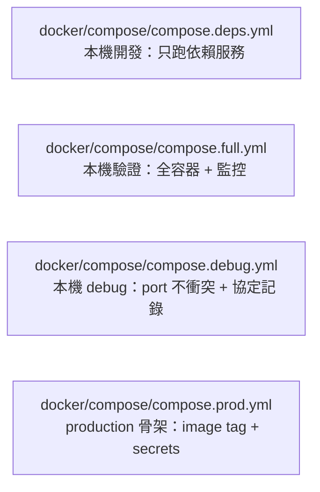

# Docker 生產部署

這份文件涵蓋 production 部署從 compose 骨架到實際上線的完整流程。

## 與其他 compose 的差異



### `docker/compose/compose.deps.yml`

用途：本機 GoLand 開發，只跑依賴服務（MySQL / Redis / RabbitMQ）。

### `docker/compose/compose.full.yml`

用途：本機完整容器驗證，驗證 image build、容器網路、監控串接。

### `docker/compose/compose.debug.yml`

用途：本機完整 debug 容器驗證，可和 `docker/compose/compose.prod.yml` 同機並跑（port 不衝突），`DEBUG_PROTOCOL_RECORD=true` 預設開啟。

### `docker/compose/compose.prod.yml`

用途：production 部署骨架，以 image tag 與 secrets/env 為主，不常駐 `user` client。

---

下面進入 production 部署的完整流程：image build → push → deploy → rollback。

## 1. 準備環境變數

先從：

- [.env.prod.example](../../.env.prod.example)

複製成你自己的 `.env.prod`，並至少修改：

- `MYSQL_ROOT_PASSWORD`
- `MYSQL_PASSWORD`
- `REDIS_PASSWORD`：正式 Redis 以 `requirepass` 啟動，Central、World、Gate、Lobby 以 `redis.password` 讀取；未設定時 compose 直接報錯
- `GRAFANA_ADMIN_PASSWORD`
- `REGISTRY`
- `IMAGE_TAG`
- `CENTRAL_IMAGE`
- `WORLD_IMAGE`
- `GATE_IMAGE`
- `CHAT_IMAGE`
- `LOBBY_IMAGE`
- `RECORD_IMAGE`
- `RABBITMQ_USER`／`RABBITMQ_PASSWORD`（密碼只用 URL 安全字元，compose 會組成 `RABBITMQ_URL`）
- `LOBBY_ADMIN_TOKEN`／`LOBBY_OPS_TOKEN`／`LOBBY_GM_TOKEN`（需要 Lobby admin 端點時；每個至少 32 字元，例如 `openssl rand -hex 32`，過短或 `change-me` 開頭會拒絕啟動）
- `DATA_CONFIG_ROOT`：宿主機上的遊戲設定 artifact root（`current.json` 與 `releases/`），以唯讀方式掛到 World 的 `/app/config/data`

不要把真正的 `.env.prod` 提交到版本庫。

### 遊戲設定 artifact

World 啟動時要求 `current.json`，正式環境不得開啟 `data_config.allow_legacy_directory`。部署前先在宿主機發布 artifact：

```powershell
.\scripts\publish-data-config.ps1 -Source config\data -Root <DATA_CONFIG_ROOT>
```

World 唯讀掛載並監看此目錄，熱重載只採用白名單內的變更，不改寫 `current.json`。熱重載被拒時 World 保留目前快照並記錄 `game_data_config_reload_total{result="rejected"}`，但 `current.json` 仍指向被拒的版本，World 重啟會改載入該版本；先以 `rollback-data-config-release.ps1` 切回可用版本，或依[配置 Artifact 發布與回退](配置Artifact發布與回退.md)完成需要重啟的變更。

### 機密與對外連接埠

- MySQL 帳密只由環境變數提供：compose 把 `MYSQL_USER`／`MYSQL_PASSWORD`／`MYSQL_DATABASE` 以 `MYSQL_USERNAME`／`MYSQL_PASSWORD`／`MYSQL_DBNAME` 注入 Central、World、Chat，設定檔的 `mysql.password` 留空。
- RabbitMQ 傳遞 World 的任務事件（道具使用、經過起點），設定含這類任務時 World 沒有 RabbitMQ 會拒絕啟動。正式 compose 內含 `rabbitmq` 服務，只在內部網路提供；World 以 `RABBITMQ_URL` 連線，設定檔的 `rabbitmq.url` 留空。
- 服務映像為必填（`${X_IMAGE:?}`），未設定時 compose 直接報錯，不會退回 `:latest`。
- Lobby admin token 只由環境變數提供；三個 token 都空白時 admin 端點停用，`change-me` 開頭的佔位值會拒絕啟動。admin 端點預設監聽容器內 `127.0.0.1:8081`，需要從內網存取時以 `LOBBY_ADMIN_ADDR` 綁內網介面。
- 只有 Gate `62001` 與 Lobby `8080` 對外。Central／World／Chat 的 S2S 連接埠與 Prometheus、Grafana 只綁主機 `127.0.0.1`；監控經 SSH 通道或反向代理存取，Prometheus 不開 lifecycle API。跨主機部署時改綁內網介面。
- 正式設定一律啟用 S2S 驗證：`.env.prod` 的 `S2S_SECRET_DIR` 指向機密目錄，compose 把其中的 `central/`、`chat/`、`world-1001/`、`gate-2001/` 分別唯讀掛載到各服務的 `/run/secrets`；缺少憑證或 token 時服務拒絕啟動。機密的產生、發送與輪替見 [[S2S身份驗證]]。
- 正式環境不傳 `FAULT_INJECT`；`go run ./tools/configaudit` 會檢查。
- 告警通知：`monitoring` profile 含 Alertmanager，告警送往 `ALERTMANAGER_SECRET_DIR`（預設 `./alertmanager-secrets`，相對於 compose 檔目錄）下 `webhook_url` 檔案內的 URL（單行，例如團隊聊天室或值班系統的接收端）。目錄或檔案不存在時告警只會留在 Alertmanager 介面（`127.0.0.1:9093`），不會通知任何人；該目錄已列入 `.gitignore`。
- Prometheus 時序資料放在具名資料卷 `prod-prometheus-data`，重建容器不會清空；保留期由 `PROMETHEUS_RETENTION` 控制（預設 `15d`）。

### 環境變數：AUTO_MIGRATE_DISABLED

所有 Go 服務在啟動初期會自動執行 `AutoMigrate` 確保資料表結構與 model 一致。
**生產環境應設 `AUTO_MIGRATE_DISABLED=true`**，由外部 migration 工具（golang-migrate / Flyway / Atlas）管理 schema：

```env
AUTO_MIGRATE_DISABLED=true
```

設定後，以下三個啟動時期的 AutoMigrate 會被跳過：

- `Central` → `user_record` 表
- `Chat` → `chat_messages` 表
- `World` → `player_item` 表

Record 例外：每日事件分表（`record_events_YYYYMMDD`）屬於資料分區，無法由一次性 migration 預先建立；`AUTO_MIGRATE_DISABLED=true` 時 Record 不建立分表且寫入會失敗。正式 compose 因此只對 Record 設 `AUTO_MIGRATE_DISABLED=false`，它只會建立自己的事件分表。

#### 升級時需手動建立的索引與欄位變更

`AUTO_MIGRATE_DISABLED=true` 時 `AutoMigrate` 不會執行，下列 2026-10 新增的結構需在升級前由外部 migration 建立（PJA-Database 尚無 plan，暫以 SQL 手動執行）：

```sql
-- Chat：歷史保留清理依 created_at 掃描
CREATE INDEX idx_chat_message_created_at ON chat_message (created_at);

-- World：combat_session 依玩家、狀態與到期時間查詢；status 需先改成 varchar(32) 才能建索引
ALTER TABLE combat_session MODIFY status varchar(32) NOT NULL;
CREATE INDEX idx_combat_session_attacker_status ON combat_session (attacker_player_id, status, expires_at);
CREATE INDEX idx_combat_session_defender_status ON combat_session (defender_player_id, status, expires_at);

-- World：任務新增本週期完成次數（週期重置任務的 MaxCompletion 以此計）
ALTER TABLE player_mission_state ADD COLUMN period_completion_count int NOT NULL DEFAULT 0;

-- Central：帳號改為精確比對（區分大小寫與重音）
ALTER TABLE `user` MODIFY `account` varchar(100) COLLATE utf8mb4_bin NOT NULL;
```

大表建索引會鎖表時間較長，請在離峰執行；`combat_session` 目前沒有刪除流程，保留期限待決定。


### 連線池設定

各服務的 MySQL 連線池採用以下預設值，可透過設定檔覆寫：

| 服務 | MaxOpenConns | MaxIdleConns | ConnMaxLifetime | ConnMaxIdleTime | 設定方式 |
|------|-------------|-------------|----------------|----------------|---------|
| Central (pkg) | 25 | 10 | 1h | 10m | `pkg/mysql.Connect` 內建 |
| Chat | 依 `cfg.MaxOpenConns` | 依 `cfg.MaxIdleConns` | 依 `cfg.ConnMaxLifetime` | 10m | `mysql_connect.go` 覆寫 |
| World | 25（可設 `MaxOpenConns`） | 10（可設 `MaxIdleConns`） | 1h | 10m | `gamedb.Config` 設 >0 時套用 |
| Record | 25 | 10 | 1h | 10m | `services.OpenDB` 內建 |

> World 的 `MaxOpenConns` / `MaxIdleConns` 設為 0 時沿用 pkg 預設值。

## 2. 建 image

```bash
REGISTRY=registry.example.com/project IMAGE_TAG=1.0.0 ./scripts/docker-build-images.sh
```

這會 build：

- `project-central`
- `project-world`
- `project-gate`

## 3. 推 image

```bash
REGISTRY=registry.example.com/project IMAGE_TAG=1.0.0 ./scripts/docker-push-images.sh
```

## 4. 部署

在部署主機上，準備：

- `docker/compose/compose.prod.yml`
- `docker/prod/config/*.yaml`
- `.env.prod`
- `DATA_CONFIG_ROOT` 指向的遊戲設定 artifact root

啟動應用：

```bash
docker compose --env-file .env.prod -f docker/compose/compose.prod.yml up -d
```

若也要監控：

```bash
docker compose --env-file .env.prod -f docker/compose/compose.prod.yml --profile monitoring up -d
```

## 5. 驗證

部署後可先跑：

```powershell
powershell -ExecutionPolicy Bypass -File ./scripts/production-smoke.ps1
```

若有啟用 monitoring profile：

```powershell
powershell -ExecutionPolicy Bypass -File ./scripts/production-smoke.ps1 -CheckMonitoring
```


```bash
docker compose --env-file .env.prod -f docker/compose/compose.prod.yml ps
docker compose --env-file .env.prod -f docker/compose/compose.prod.yml logs --tail 100 central world gate
```

確認：

- `mysql` / `redis` healthy
- `central` / `world` / `gate` healthy
- 若有開監控，`prometheus` / `grafana` up

## 6. 更新版本

1. build 新 tag
2. push 新 tag
3. 修改 `.env.prod` 內的：
   - `IMAGE_TAG`
   - `CENTRAL_IMAGE`
   - `WORLD_IMAGE`
   - `GATE_IMAGE`
4. 重新部署：

```bash
docker compose --env-file .env.prod -f docker/compose/compose.prod.yml up -d
```

## 7. 回滾

如果新版本有問題：

1. 把 `.env.prod` 的 image tag 改回上一版
2. 再執行一次：

```bash
docker compose --env-file .env.prod -f docker/compose/compose.prod.yml up -d
```

因為 compose 以 image tag 為主，所以 rollback 的核心就是把 tag 指回上一個穩定版本。

## 8. 目前邊界

這套 production 部署目前仍是單機骨架，尚未處理：

- TLS / ingress / L4 LB
- secret manager
- 受管 MySQL / Redis
- 多節點部署
- 自動備份與 restore 演練
- CI/CD 自動發版

## 9. 建議順序

若你要真的上線，我建議下一批優先做：

1. DB / Redis 備份腳本
2. deploy 主機目錄結構規範
3. registry login / release 流程
4. production health check / smoke test

## 10. 升級相容性演練

先在 staging 跑 rolling upgrade：

```powershell
powershell -ExecutionPolicy Bypass -File ./scripts/upgrade-compatibility-drill.ps1 -NewTag 1.0.1 -Rollback
```

順序固定：

1. `central`
2. `world`
3. `gate`

每步都會跑 smoke，確認舊新混跑還能起。
`-Rollback` 會在升級完成後再反向退回舊版，驗證回滾也能收斂。

若要比較不同部署方案，先看 [部署方案比較.md](./部署方案比較.md)。

資料備份與還原請參考 [[Docker備份還原]]。


release / version 流程請參考 [[Docker發版流程]]。

版本保留與回收條件請參考 [版本回收策略.md](./版本回收策略.md)。

灰度回退點請參考 [灰度回退點.md](./灰度回退點.md)。
