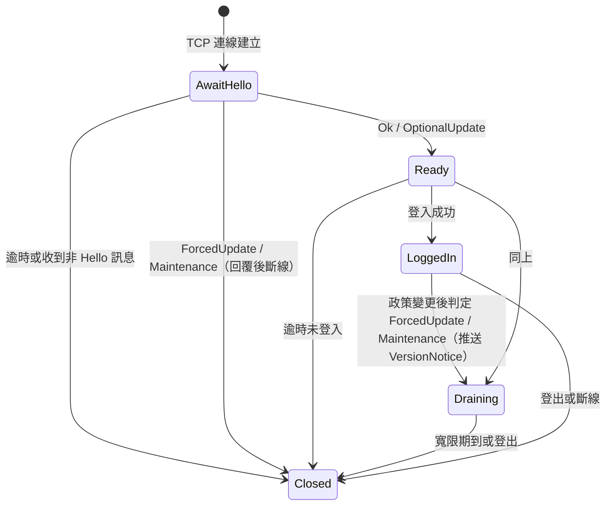
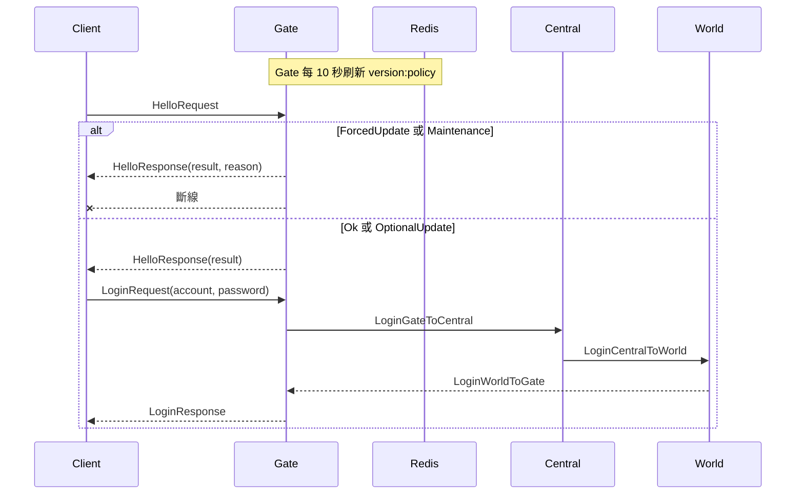
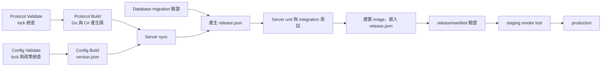

# 版本相容重新規劃（完整方案）

本文件不以最小改動為限制，重新設計 Client、Server、Config、Protocol 與 Database 的版本相容架構。評估基準日：2026-10-12。定案後以本文件改寫 `版本與串接規範.md`。

## 0. 摘要

- 每種版本只有一個來源，由產生流程寫出；是否該提升版本由 CI 用 schema 指紋自動檢查。
- Client 連上 Gate 的第一個訊息是 `HelloRequest`；Gate 在登入前判斷「正常／可選更新／強制更新／維護」，強制更新直接斷線。
- 設定隨安裝包送達，並可於啟動時依 manifest 下載更新；Client 不在執行中下載設定。下載的設定須通過契約與雜湊校驗，失敗即沿用內建設定（見第 6.5 節）。
- 「設定必須更新」用只增不減的 `config_seq` 與 `min_config_seq` 判斷；「程式必須更新」用各平台的 `min_game_version` 判斷，營運可即時調整。
- Server 服務之間改為連線時交換一次 `ServiceHello`，刪除每個 S2S 訊息上的版本欄位。
- CI 產生 `release.json` 嵌入每個 Server binary；服務啟動時自我驗證協定、設定與 DB schema，不一致就不啟動。

## 1. 前提

| 前提 | 依據 | 對設計的影響 |
|---|---|---|
| 專案仍在開發階段，尚未對外發布 | `PJA-Protocol/README.md`：開發階段只保留現行訊息 | 一次切換，不保留舊流程的過渡相容 |
| Protocol 與 Config 都用 Luban binary，依 schema 欄位順序讀寫，沒有欄位標籤 | `PJA-Protocol/README.md` 最後一節 | 既有訊息或設定表只要增刪、調換、改型別任一欄位，舊端就無法解析；「向下相容的欄位修改」不存在 |
| 新增全新訊息不影響既有訊息 | 接收端依 `messageId` 分派，未知 ID 可忽略 | 只有「新增」可以不提升版本 |
| 所有 Server 服務以同一個 release 一起部署 | `release/manifest.example.yaml` 六個服務同一標籤 | 服務之間不需要逐訊息帶版本 |
| Client 不支援執行中下載設定 | 已定案 | 設定變更透過新安裝包或下次啟動時的下載送達玩家 |
| Gate 已使用 Redis 並有 GM 指令 | `cmd/gate/internal/app`、`cmd/gate/internal/gm` | 執行期更新政策放 Redis，沿用 GM 指令調整 |

## 2. 現況問題

| # | 問題 | 證據 |
|---|---|---|
| P1 | Client 沒有送協定版本，`protocolVersion` 由 Gate 自填 `V1`，World 的檢查永遠通過 | `protocol.xml` 的 `LoginRequest`；`cmd/gate/internal/flow/user/login/forward.go:30` |
| P2 | 協定版本有兩個來源，產生碼的常數無人引用 | `pkg/protocol/message_id.go:12`；`pkg/msg/protocol_version.go:5` |
| P3 | 協定版本 lock／blacklist 沒有接線，只有測試使用 | `pkg/msg/protocol_version_config.go` |
| P4 | 版本檢查在登入鏈最後一站 World，不相容的 Client 仍走完 Gate、Central 與帳密驗證 | `cmd/world/internal/flow/login/route.go:25-42` |
| P5 | Client 沒有送 `config_version`、`game_version` | `LoginRequest` 只有 `clientContract` |
| P6 | `compatibility` 名稱三處不一致，執行時無人讀取 | 規範第 1 節規則 6、`pkg/dataconfig/manifest.go`、`PJA-Config/Scripts/Generate-Version.ps1:40` |
| P7 | `client_contract` 寫死在腳本 | `Generate-Version.ps1:39` |
| P8 | `releasemanifest` 不比對 `client_contract` 與協定版本；範例檔 Luban 版本過時 | `tools/releasemanifest/validate.go`；`release/manifest.example.yaml` |
| P9 | 0 值一律放行 | `NormalizeProtocolVersion`、`matchesClientContract` |
| P10 | 每個 S2S 訊息都帶 `protocolVersion` | `protocol.xml` S2S 模組、`ReqMeta` |
| P11 | 版本該不該提升全靠人判斷 | 規範第 1 節規則 3、4 |
| P12 | 規範要求啟動時讀取 release manifest 與確認 DB schema，沒有實作 | 規範第 4 節 |
| P13 | 無法區分可選更新與強制更新，也無法針對單一平台要求更新 | 無相關欄位 |

## 3. 設計原則

1. 每種版本只有一個來源，由產生流程寫出，不手抄。
2. 是否需要提升版本由 CI 自動判斷，人只負責提升。
3. 每條連線只檢查一次，在第一個訊息就檢查。
4. 回覆結果與原因要可區分，Client 才能顯示正確提示，問題回報也能定位。
5. Server 啟動時自我驗證整個版本組合，不一致就不啟動。
6. 緊急處置（強制更新）不必等 Server 重新發版。

## 4. 版本模型

| 版本 | 來源 | 提升方式 | 檢查位置與規則 |
|---|---|---|---|
| `protocol_version` | `PJA-Protocol/Datas/protocol.xml` 根節點屬性 `version` | 人提升；CI 以 `protocol.lock.json` 擋下漏提升 | Gate Hello，必須相等 |
| `client_contract` | `PJA-Config` 受版控的版本政策檔 | 人提升；CI 以 `config.lock.json` 擋下漏提升 | Gate Hello，必須相等 |
| `config_version` | `PJA-Config` Git SHA，寫入 `version.json` | 自動 | 只用於識別與診斷 |
| `config_seq` | `PJA-Config` 主線 commit 數，寫入 `version.json` | 自動，只增不減 | Gate Hello，與 `min_config_seq` 比較 |
| `min_config_seq` | `PJA-Config` 版本政策檔 | 人以腳本標記「這次必須更新」 | Gate Hello |
| `game_version` | Client 安裝包版本，SemVer | Client 發版流程 | Gate Hello，與 `min_game_version`、`latest_game_version` 比較 |
| `min_game_version` | Redis 更新政策，依平台 | 營運以 GM 指令調整 | Gate Hello |
| `latest_game_version` | Redis 更新政策，依平台 | 新安裝包上架時以 GM 指令調整 | Gate Hello |
| `database_schema` | `PJA-Database` 最新 migration | 新增 migration | 服務啟動時查 DB，必須相等 |
| `release` 組合 | CI 產生的 `release.json`，嵌入每個 Server binary | 自動 | 服務啟動自我驗證；CI 以 `releasemanifest` 驗證 |

刪除：`compatibility` 字串、協定 lock／blacklist、手寫 `ProtocolVersionV1`／`ProtocolVersionCurrent`、S2S 訊息與 `ReqMeta` 內的 `protocolVersion`、`LoginRequest` 的 `clientContract`、兩處 0 值放行、World 登入時的契約與協定檢查。

不採用版本範圍（同時支援多個協定版本）：Luban binary 沒有欄位標籤，同時支援兩版需要兩套編解碼，成本遠高於強制更新。日後有灰度需求再改為 `[min, current]`，模型不需重做。

## 5. 版本提升的自動檢查

Protocol 與 Config 用同一種機制。

1. 驗證腳本對每個項目計算 schema 指紋：欄位名稱、型別、順序與標籤正規化後取 SHA-256。
   - Protocol：每個 bean 與 enum。
   - Config：Client 會讀取的每張表與其引用的 bean、enum。
2. 指紋與版號存入受版控的 lock 檔：

   ```json
   {
     "protocol_version": 2,
     "items": {
       "Auth.Protocol.LoginRequest": "9f2c…",
       "Connection.Protocol.HelloRequest": "41ab…"
     }
   }
   ```

3. `Validate.ps1` 規則：
   - 既有項目指紋改變或被刪除，而版號沒有提升：失敗，訊息列出變更項目。
   - 只新增項目：通過；`-UpdateLock` 寫入新項目。
   - 版號提升：`-UpdateLock` 重寫整份 lock 檔。
   - 版號只增不減。
4. Protocol 產生碼輸出版號與整體指紋：Go `protocol.ProtocolVersion`、`protocol.SchemaHash`；C# 同名常數。
5. Config `version.json` 輸出 `client_contract`、`config_seq`、`min_config_seq` 與 Client 設定整體指紋。

## 6. 更新判斷

更新對象只有 Client 安裝包。Gate 依下表由上而下判斷，第一個成立的即為結果。

| 順序 | 情況 | 例子 | 判斷 | 結果 | 原因 |
|---|---|---|---|---|---|
| 1 | 維護中 | 停機更新 | Redis 維護旗標為開 | `Maintenance` | `None` |
| 2 | 協定版本不同 | 封包欄位改了 | `protocolVersion != Server` | `ForcedUpdate` | `ProtocolMismatch` |
| 3 | 設定格式不同 | 設定表欄位改了 | `clientContract != Server` | `ForcedUpdate` | `ClientContractMismatch` |
| 4 | 程式太舊 | 修補外掛漏洞 | `gameVersion < min_game_version[platform]` | `ForcedUpdate` | `GameVersionTooOld` |
| 5 | 設定太舊 | 新增道具，舊設定缺資料 | `configSeq < min_config_seq` | `ForcedUpdate` | `ConfigTooOld` |
| 6 | 有新安裝包但舊版可玩 | 調整數值、文字或小修正 | `gameVersion < latest_game_version[platform]` | `OptionalUpdate` | `None` |
| 7 | 其他 | | | `Ok` | `None` |

`gameVersion` 無法解析為 SemVer 時視為強制更新（`GameVersionTooOld`）。SemVer 比較使用 `github.com/Masterminds/semver/v3`（已在 `go.mod`，改為直接依賴）。

Server 熱更新設定後，線上 Client 的設定可能比 Server 舊。這屬於可接受情況：Server 是權威，結果以 Server 為準，Client 只是顯示舊數值，等下一個安裝包更新。

原則：熱更新只用於「不需要強制更新」的變更（調數值、改文字、修 Server 內部問題）。需要強制更新的變更一律走維護發版，所有玩家同時切換，不留新舊混雜的時段（見第 9.3、10.2 節）。

### 6.1 `config_seq`

`config_version` 是 Git SHA，只能判斷相同與否，不能判斷新舊。`config_seq` 取 PJA-Config 主線 `git rev-list --count --first-parent HEAD`，由 `Generate-Version.ps1` 寫出。正式產物只能從主線產生；分支產物的 `config_seq` 僅供測試，CI 不得以分支產物發版。

### 6.2 標記「這次必須更新」

1. PJA-Config 新增受版控的版本政策檔 `Datas/version-policy.json`：

   ```json
   { "client_contract": 1, "min_config_seq": 120 }
   ```

2. 內容必須更新的變更，在同一個 commit 執行 `Scripts/Mark-RequiredUpdate.ps1`，腳本把 `min_config_seq` 設為「目前主線序號 + 1」，即這個 commit 合入後的序號。
3. 之後的一般變更不動政策檔。
4. `Validate.ps1` 檢查：`min_config_seq` 只增不減，且不大於目前 `config_seq`。
5. 提高 `client_contract` 時，`min_config_seq` 一併設為目前序號（格式變了，舊設定一定不能用）。

### 6.3 Redis 更新政策

Gate 讀取 Redis key `version:policy`（JSON）：

```json
{
  "maintenance": { "enabled": false, "end_at": "" },
  "kick_grace_seconds": 60,
  "platforms": {
    "android": { "min": "1.2.0", "latest": "1.4.0" },
    "ios":     { "min": "1.2.0", "latest": "1.3.2" },
    "windows": { "min": "1.2.0", "latest": "1.4.0" }
  }
}
```

- 依平台分開：各平台上架時間不同，不能用同一個版本號強制所有平台。
- Gate 每 10 秒刷新一次並快取；Redis 讀取失敗時沿用上次值，啟動時讀不到則全部放行為 `Ok` 並記錄錯誤（避免 Redis 短暫故障擋下所有玩家）。
- 新增 GM 指令設定維護旗標與各平台 `min`／`latest`；寫入前驗證 SemVer 格式與 `min <= latest`。
- `Maintenance` 結果先在協定預留；維護旗標與 GM 指令可與本方案一起做，也可延後，不影響協定。
- `min_config_seq` 只來自嵌入的 `release.json`，不放 Redis，因此只能隨發版改變。

### 6.4 線上玩家的重新判斷

Hello 只在連線時檢查一次，政策變嚴後已在線的舊版玩家仍會留在遊戲裡。因此：

1. Gate 每次刷新政策，若任一平台 `min`／`latest` 或維護旗標有變，就用每條連線記下的 Hello 資料重新跑第 6 節判斷表。
2. 結果變成 `ForcedUpdate` 或 `Maintenance`：推送 `VersionNotice`，等 `kick_grace_seconds` 後斷線。寬限期讓玩家看到提示、Server 有時間完成存檔；寬限期內 Gate 不再接受新的遊戲 Command，只處理登出。
3. 結果變成 `OptionalUpdate`（原本是 `Ok`）：推送 `VersionNotice`，不斷線。
4. 每條連線同一個結果只推送一次。

### 6.5 啟動時下載設定

Client 只在啟動時檢查並下載設定，不在執行中下載。每次啟動都會請求一次 `latest.json`；只有需要更新時才請求 `manifest.json` 與設定檔。

#### 6.5.1 靜態主機檔案

CDN 上的路徑與用途如下：

| 路徑 | 用途 | 快取 |
|---|---|---|
| `config/latest.json` | 指標檔，說明目前最新版是哪一版 | 短（約 60 秒） |
| `config/<config_version>/manifest.json` | 該版的完整清單 | 長（不可變） |
| `config/<config_version>/<檔名>.bytes` 等 | 設定檔本體 | 長（不可變） |

`latest.json` 範例：

```json
{
  "config_version": "9f2c1e7a8b0d4c6e2f1a3b5c7d9e0f1a2b3c4d5e",
  "config_seq": 128,
  "min_config_seq": 120,
  "client_contract": 1,
  "manifest": "config/9f2c1e7a8b0d4c6e2f1a3b5c7d9e0f1a2b3c4d5e/manifest.json",
  "published_at": "2026-11-06T10:00:00+08:00"
}
```

`manifest.json` 範例：

```json
{
  "config_version": "9f2c1e7a8b0d4c6e2f1a3b5c7d9e0f1a2b3c4d5e",
  "config_seq": 128,
  "min_config_seq": 120,
  "client_contract": 1,
  "schema_hash": "3a7f…（sha256）",
  "base_path": "config/9f2c1e7a8b0d4c6e2f1a3b5c7d9e0f1a2b3c4d5e/",
  "files": {
    "Item.bytes": { "sha256": "b1c2…", "size": 40213 },
    "Monster.bytes": { "sha256": "d4e5…", "size": 8821 },
    "version.json": { "sha256": "f6a7…", "size": 312 }
  }
}
```

欄位說明：

- `latest.json` 只讀 `config_seq`、`client_contract` 即可決定是否下載；`manifest` 指向該版清單。
- `manifest.json` 的 `files` 列出該版所有設定檔，每檔附 `sha256` 與 `size`。Client 只下載需要的檔，但校驗依 `files` 全部進行。
- `schema_hash` 為設定結構指紋，與安裝包內的值比對。

#### 6.5.2 產生與發布（CI）

`latest.json` 與 `manifest.json` 由 CI 自動產生，不手寫。來源如下：

- `config_version`、`config_seq`：PJA-Config 產出的 `version.json`。
- `client_contract`、`min_config_seq`：PJA-Config 的 `Datas/version-policy.json`（第 6.2 節）。
- `files`、`sha256`、`size`：產物目錄內的檔案。
- `manifest` 路徑、`base_path`：由 `config_version` 組出。

發布順序：

1. 設定產物驗證通過，Server 發布 `releases/<config_version>/` 與 `current.json`（現有流程）。
2. 上傳 `config/<config_version>/` 下的設定檔與 `manifest.json`。
3. 全部上傳成功後，才覆寫 `config/latest.json`，並設定短快取。
4. 任一步失敗即停止，不覆寫 `latest.json`，玩家仍拿到舊的完整版本。

`latest.json` 只在最後一步覆寫，因此玩家不會看到指向不完整版本的指標。

#### 6.5.3 Client 啟動流程

```
開遊戲
  │
  ├─ 1. 請求 config/latest.json
  │      ├─ 逾時或失敗 → 用安裝包內設定，結束
  │      └─ 成功 ↓
  │
  ├─ 2. 比對 latest.json 與安裝包
  │      ├─ client_contract 不同 → 不更新，用安裝包內設定，結束
  │      ├─ config_seq ≤ 安裝包內 config_seq → 不更新，結束
  │      └─ 其餘 ↓
  │
  ├─ 3. 請求 manifest.json
  │      ├─ 逾時或失敗 → 用安裝包內設定，結束
  │      └─ 成功 ↓
  │
  ├─ 4. 校驗 manifest.json
  │      ├─ client_contract 與安裝包不同 → 不採用，結束
  │      ├─ min_config_seq 與安裝包不同 → 不採用，結束（同第 9.3 節）
  │      ├─ schema_hash 與安裝包不同 → 不採用，結束
  │      └─ 通過 ↓
  │
  ├─ 5. 逐檔請求 base_path + 檔名，算 sha256 與 size 比對
  │      └─ 任一檔不符 → 全部丟棄，用安裝包內設定，結束
  │
  ├─ 6. 全部通過 → 寫入暫存目錄，整批改名換用新設定
  │
  └─ 7. 本次啟動使用新設定；HelloRequest 的 configSeq、configVersion 填新值
```

#### 6.5.4 規則

1. 下載只在啟動時進行，不做執行中替換；新設定於本次啟動生效。
2. 寫入中斷不得留下半套設定，以暫存目錄整批切換。
3. 任何步驟失敗都退回安裝包內的設定，遊戲照常進行。
4. CDN 故障不影響 Server；Server 的 `ConfigTooOld` 判斷依 Client 回報的 `configSeq` 不變。
5. 逾時秒數、重試次數、是否快取檢查結果（例如同一天內不重複檢查）由 PJA-Client 負責人定案；Server 不需為此改協定。

## 7. Client 與 Gate 握手

新增 Connection 模組訊息，與 `HeartbeatRequest`、`TimeSyncRequest` 同一模組、使用 Client 區段的 ID。

```text
HelloRequest  (c2s, Client → Gate)
  protocolVersion  short
  schemaHash       string   // 診斷用，不參與判斷
  clientContract   int
  configVersion    string   // 40 碼 SHA，診斷用
  configSeq        int
  gameVersion      string   // SemVer
  platform         Platform

HelloResponse (s2c, Gate → Client)
  result             VersionResult
  reason             UpdateReason
  protocolVersion    short    // Server 目前值，供 Client 顯示與回報
  clientContract     int
  latestGameVersion  string   // 該平台最新版本
  maintenanceEndAt   long     // Unix 秒；非維護為 0
  release            string

VersionNotice (s2c event, Gate → Client，線上政策變更時推送)
  result             VersionResult
  reason             UpdateReason
  latestGameVersion  string
  disconnectAt       long     // Unix 秒；不斷線為 0
  maintenanceEndAt   long

enum Platform       Unknown = 0, Windows, Android, Ios, Mac
enum VersionResult  Unknown = 0, Ok, OptionalUpdate, ForcedUpdate, Maintenance
enum UpdateReason   Unknown = 0, None, ProtocolMismatch, ClientContractMismatch, GameVersionTooOld, ConfigTooOld
```

`HelloRequest`、`HelloResponse`、`VersionNotice` 與三個列舉的欄位一經發布不得變動（列舉只能新增值）；即使 `protocol_version` 提升，舊 Client 仍要能讀懂「請更新」。它們的指紋在 lock 檔中標記為凍結，Validate 對凍結項目的任何變更一律失敗。

### 7.1 Gate 連線狀態



- `AwaitHello` 只接受 `HelloRequest`；其他訊息直接斷線，不回覆。
- Hello 逾時沿用現有連線 deadline 設定。
- `Ready` 才接受 `LoginRequest`；`LoginRequest` 不帶任何版本欄位。
- Hello 結果與 Client 回報的版本記在連線上，後續 log 一併帶出。
- `HeartbeatRequest`、`TimeSyncRequest` 只在 `Ready` 之後接受。

### 7.2 流程



### 7.3 觀測

- 每次 Hello 記錄 `result`、`reason`、`platform`、`gameVersion`、`configSeq`。
- 指標：依 `result`、`reason`、`platform` 計數；依 `platform`、`gameVersion` 統計在線分布，作為調整 `min_game_version` 的依據。

### 7.4 安全

- Hello 未經驗證，Client 送來的版本值只用於判斷是否放行，不寫入玩家資料。
- 偽造版本號只能繞過提示；協定或設定真的不相容時，該 Client 仍無法正確解析，Server 仍是權威。
- Hello 階段沿用 Gate 現有的連線速率限制。

## 8. Server 服務之間

- 刪除所有 S2S 訊息的 `protocolVersion` 欄位，`ReqMeta` 只保留 `requestId`。
- 新增 S2S 訊息 `ServiceHello`（`group="s2s"`），服務連線建立後雙方各送一次：`release`、`serverCommit`、`protocolSchemaHash`、`clientContract`、`appType`、`appId`。
- 任一欄位（`appType`、`appId` 除外）不同即拒絕連線並記錄錯誤，擋下混部署。
- 未完成 `ServiceHello` 前，連線上的其他 S2S 訊息一律丟棄。
- `ServiceHello` 同樣凍結，規則同第 7 節。

## 9. 發版組合與啟動自我驗證

### 9.1 `release.json`

CI 產生並以 `go:embed` 嵌入每個 Server binary（放在 `pkg/release`，建置前由 CI 寫入；本機開發使用版控中的 `release.dev.json`）：

```json
{
  "release": "1.0.0",
  "server_commit": "<40 碼>",
  "protocol_version": 2,
  "protocol_schema_hash": "<sha256>",
  "config_version": "<40 碼>",
  "config_seq": 128,
  "min_config_seq": 120,
  "client_contract": 1,
  "luban_version": "5.0.0",
  "database_schema": "000012"
}
```

### 9.2 啟動檢查

每個服務啟動時依序檢查，任一不符即拒絕啟動並輸出差異：

1. 產生碼的 `protocol.ProtocolVersion`、`protocol.SchemaHash` 等於 `release.json`。
2. 載入設定的服務：`version.json` 的 `config_version`、`client_contract`、`min_config_seq` 等於 `release.json`。
3. 使用 DB 的服務：migration 紀錄表的目前 schema 等於 `release.json`。
4. 整份 `release.json` 寫入啟動 log，`opsdiag` 診斷輸出可查詢。

本機開發的 `release.dev.json` 以 `"release": "dev"` 標示，略過第 1、2 項以外的檢查。

### 9.3 設定熱更新

熱更新只用於不需要強制更新的變更。新的設定必須符合：

- `client_contract` 與執行中相同。
- `min_config_seq` 與執行中相同。

任一不符一律拒絕：這兩種變更代表舊安裝包的設定不能再用，必須走維護發版（第 10.2 節），讓所有玩家同時切換。熱更新期間若讓新設定先生效，線上舊 Client 會在寬限期內收到它讀不懂的內容（例如不存在的道具 ID），可能顯示錯誤或崩潰。

### 9.4 `releasemanifest`

- `release/<release>.yaml` 取消，改以 `release.json` 為唯一發版紀錄，與 release tag 一起保存。
- `tools/releasemanifest` 改為驗證 `release.json`：比對 PJA-Config `version.json`、`protocol.lock.json`、migration 清單與 image tag；`client_contract`、`min_config_seq`、`protocol_version`、指紋都必須一致。
- `release/manifest.example.yaml` 刪除，改提供 `release.dev.json`。

## 10. CI 與上線

### 10.1 Pipeline



### 10.2 上線順序

| 變更類型 | 順序 |
|---|---|
| 一般變更（不動版本） | Server 部署即可 |
| 新安裝包，可選更新 | 上架後以 GM 指令調高該平台 `latest` |
| 提升 `protocol_version`、`client_contract` 或 `min_config_seq` | 1. 新安裝包送審並上架<br/>2. 維護旗標開啟<br/>3. 部署 Server<br/>4. 以 GM 指令調高 `latest`（必要時調高 `min`）<br/>5. 維護旗標關閉 |
| 緊急強制更新（例如外掛漏洞），Server 不需改 | 1. 新安裝包上架<br/>2. 以 GM 指令調高該平台 `min`；線上舊版玩家依第 6.4 節推送通知，寬限期後斷線 |
| Server 熱修，Client 不需改 | Server 部署即可，不動版本政策 |

## 11. 實作工作分解

一次切換，不保留舊流程。

### PJA-Protocol

- `Datas/protocol.xml`：根節點加 `version="2"`；新增 `Platform`、`VersionResult`、`UpdateReason`、`HelloRequest`、`HelloResponse`、`ServiceHello`；刪除 S2S 訊息與 `ReqMeta` 的 `protocolVersion`；刪除 `LoginRequest` 的 `clientContract`；刪除 `AuthResultCode.ProtocolMismatch`。
- `Scripts/ProtocolSchema.ps1`：指紋計算。
- `Scripts/Validate.ps1`：lock 檢查、凍結項目檢查、`-UpdateLock`。
- `protocol.lock.json`：新增並納入版控。
- `Scripts/BuildServer.ps1`：版號改從 xml 讀取；輸出 `ProtocolVersion`、`SchemaHash`。
- Client C# 產出：同名常數。
- `README.md`：新增版本與 lock 規則、訊息 ID 區段表加入 Hello。

### PJA-Config

- `Datas/version-policy.json`：新增。
- `config.lock.json`：新增並納入版控。
- `Scripts/Mark-RequiredUpdate.ps1`：新增。
- `Scripts/Validate.ps1`：Client 設定表 lock 檢查、政策檔檢查。
- `Scripts/Generate-Version.ps1`：讀取政策檔；寫出 `config_seq`、`min_config_seq`、`client_contract`、Client 設定指紋；移除 `compatibility`。
- `README.md`：版本政策與標記流程。

### PJA-Server

- `pkg/msg`：刪除 `protocol_version*.go` 與相關測試；`RequestMeta()` 只回傳 `requestId`。
- `pkg/dataconfig/manifest.go`：刪除 `Compatibility`；新增 `ConfigSeq`、`MinConfigSeq`；驗證只增不減與必填。
- `pkg/release`（新增）：嵌入與載入 `release.json`、啟動自我驗證。
- `pkg/versionpolicy`（新增）：第 6 節判斷表的純函式、Redis 政策讀取與快取。
- `cmd/gate`：連線狀態機（`AwaitHello`／`Ready`／`LoggedIn`）、Hello 處理、GM 指令、指標；登入轉送不再填版本。
- `cmd/central`、`cmd/world`：刪除登入鏈上的版本傳遞與檢查（`route.go` 的 `matchesClientContract`、`ValidateProtocolVersion`）。
- 所有服務：`ServiceHello` 交換、啟動自我驗證、DB schema 檢查。
- 設定熱更新（`pkg/dataconfig/artifact_publish.go` 與 World 快照）：第 9.3 節規則。
- `tools/releasemanifest`：改驗 `release.json`。
- `tools/loadtest`、`tools/flowreplay`、`integration/testenv`：先送 Hello 再登入。
- `scripts/sync-protocol.ps1`、`tools/Build-And-Sync-Config.ps1`：同步新產物。
- `release/`：刪除 `manifest.example.yaml`，新增 `release.dev.json`。

### PJA-Database

- 確認 migration 紀錄表的查詢方式，提供 Server 讀取目前 schema 的 SQL。

### PJA-Docs

- 改寫 `版本與串接規範.md`：第 1 節版本表、第 3 節 Client 規則、第 4 節 Server 規則、第 6 節握手流程、第 8 節 manifest 與 CI。
- `名詞定義.md`：新增 `config_seq`、`min_config_seq`、可選更新、強制更新。

### 建議順序

1. PJA-Protocol、PJA-Config 的指紋與 lock 機制（不改訊息，先讓 lock 檔反映現況）。
2. 協定變更、版本政策檔、產生碼。
3. Server：`pkg/versionpolicy`、`pkg/release`、Gate 握手、刪除舊檢查、`ServiceHello`、啟動檢查。
4. 工具與 integration 測試。
5. 文件改寫。
6. 通知 PJA-Client 負責人。

## 12. 測試計畫

| 範圍 | 內容 |
|---|---|
| `pkg/versionpolicy` | 第 6 節每一列各一個表格測試；SemVer 解析失敗；平台不存在；Redis 讀取失敗沿用舊值 |
| Protocol／Config Validate | 欄位變更未提升版號應失敗；只新增應通過；凍結項目變更應失敗；版號倒退應失敗 |
| `pkg/release` | 協定、設定、DB 任一不符應拒絕啟動 |
| 熱更新 | `client_contract` 或 `min_config_seq` 與執行中不同應拒絕；其他變更應通過 |
| 線上重新判斷 | 政策變嚴後線上舊版連線收到 `VersionNotice` 並於寬限期後斷線；變成可選更新只推送不斷線；同結果不重複推送 |
| Gate integration | 未 Hello 直接登入被斷線；Hello 逾時；四種結果的回覆與斷線行為；`OptionalUpdate` 可正常登入 |
| `ServiceHello` | release 不同的服務互連應被拒絕 |
| `releasemanifest` | 各欄位不一致的失敗案例 |

## 13. 刻意不做

- 同時支援多個協定版本：理由見第 4 節。
- Client 執行中下載設定：已定案不支援。
- 獨立的 HandshakeAccepted／VersionMismatch 以外的版本協商：Hello 一次往返即可。
- 依帳號或地區做灰度強制更新：目前沒有需求；Redis 政策結構可再擴充。

## 14. 已定案

1. Gate 的協定、設定版本值來自嵌入的 `release.json`；平台版本政策與維護旗標來自 Redis。
2. Client 不支援執行中下載設定；設定隨安裝包送達，並可於啟動時依第 6.5 節下載更新。
3. 更新分可選與強制；強制更新原因分四種。
4. 刪除 `compatibility` 字串與協定 lock／blacklist。
5. 尚未發布，一次切換。

## 15. 需要外部配合

- PJA-Client 負責人：連線後先送 `HelloRequest`；依 `VersionResult` 顯示正常、可選更新、強制更新與維護提示；安裝包內帶入 `game_version`、`config_seq`、`config_version`、`client_contract`、`protocol_version`、`schemaHash` 與平台；問題回報附上這些值與 `HelloResponse.release`。
- 啟動時下載設定：實作第 6.5 節的 manifest 取得、校驗、原子切換與快取；設定 CDN 或靜態主機的 URL 與發布流程由 PJA-Config 與營運決定。
